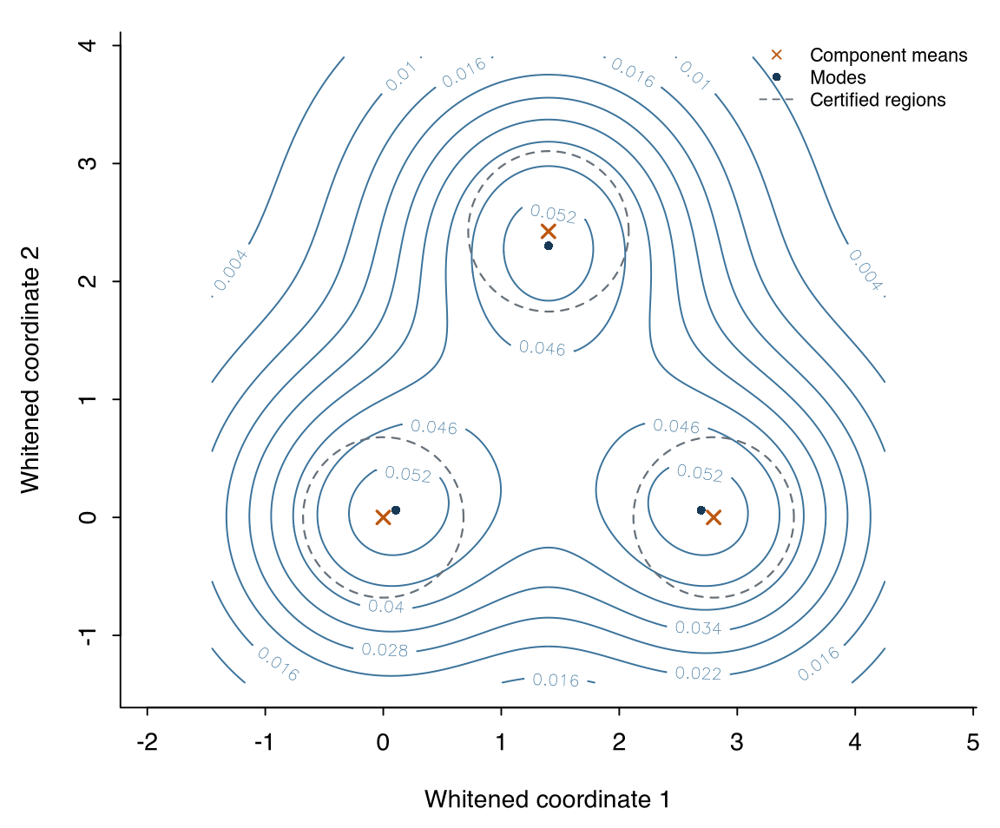

# Likelihood estimation of Gaussian mixtures with one mode per component

R implementation and manuscript for fitting finite Gaussian mixtures with a shared full covariance and a finite sufficient certificate for one nondegenerate mode per component.

The repository reproduces the three geometric examples, the triangle contour figure, three fixed-budget EM/MM steps on the supplied 96 observations, and one joint-budget step on twelve deterministic observations. It also generates local-radius and fitting-diagnostic graphics. These are the numerical illustrations in the current paper. A comparative simulation study and substantive application remain future work.

[Read the manuscript](manuscript/manuscript.pdf) · [Numerical results](results/fitting_summary.csv) · [Verification record](verification/independent_fit_review.md)



## Reproduce the calculations

Use R 4.4 or later. Run these commands from the repository root:

```sh
Rscript scripts/bootstrap.R
Rscript scripts/run_all.R
Rscript scripts/verify.R
```

The bootstrap script installs missing packages into `.R-library/` inside this project. The R computations use `CVXR`, `clarabel`, `gmp`, and `jsonlite`. They do not call Python. The supplied results were produced with R 4.4.0, CVXR 1.8.1 and Clarabel 0.11.2. Full environment details are in [results/sessionInfo.txt](results/sessionInfo.txt).

`run_all.R` writes results, figures, and generated LaTeX values. It reads the supplied 96-row data file. R and NumPy use different random-number generators, so recreating those observations from the original NumPy seed would change the experiment.

To compile the manuscript, install XeLaTeX and run:

```sh
latexmk -cd -xelatex -interaction=nonstopmode -halt-on-error manuscript/manuscript.tex
```

A BibTeX run is unnecessary. The reference list is included directly.

## Find the implementation

| Path | Contents |
| --- | --- |
| `R/core.R` | Mixture densities, posterior moments, mode locations and localization radii |
| `R/geometry.R` | Floating-point evaluations of the three geometric examples |
| `R/exact_geometry.R` | 31 strict sign checks using exact rational arithmetic |
| `R/fit.R` | Convex inner fixed-budget and joint-budget EM/MM calculations |
| `R/graphics.R` | Contour, local-radius and fitting-diagnostic figures |
| `data/` | Supplied 96 observations and the twelve deterministic observations |
| `results/` | Full numerical states, constraint checks, tables and environment record |
| `manuscript/` | Editable source, generated numerical values and compiled paper |
| `legacy/python/` | Original Python code and saved numerical records |
| `verification/` | Executed checks and independent review records |

The fitting entry points are `fit_fixed(X, steps = 3L)`, `fit_joint()`, and `fit_fixed_density_sdp()`. The fitting examples currently use three components in two dimensions and the paper's fixed settings. General density and mode calculations accept arbitrary compatible mean matrices. The fitting routines are research implementations for these examples, rather than a general mixture-fitting package.

Each accepted fitting step retains its anchor, raw trial and accepted state. The state contains `B`, transformed means `v`, logits `alpha`, radii `r`, centres `c`, odds caps `a`, and matrix multipliers `lam`. Joint-budget states also contain the budget matrices `M` and values `nu`. In R, the dimensions of `lam` are ordered-pair × coordinate × coordinate. The pair order is returned by `fit_pairs(K)`. Physical means solve `B mu = v`, and the shared covariance is `solve(B) %*% t(solve(B))`.

## Interpret the checks

The fixed-budget likelihood gains agree with the archived Python run to within `7e-8`. The native R joint-budget run is a separate computed step; its likelihood gain differs by about `1.7e-6`, and its certificate witnesses and proximal penalty also differ. The manuscript reports the native R values. Both joint-budget runs report `optimal_inaccurate`.

All four R accepted states passed direct nonlinear feasibility, convex inner feasibility, physical-coordinate likelihood and ascent checks. An independent review recomputed these quantities without sourcing the fitting helpers. The fixed-density SDP agrees with its analytic value to about `1e-10`.

Exact rational certificates apply to the geometric examples. Fitted-state checks use floating-point arithmetic. CVXR did not expose a primal–dual gap for these runs, so the records mark it unavailable. Solver tolerances and a status flag do not establish a vanishing sequence of inner gaps. These bounded runs do not establish convergence of a longer trajectory or global likelihood optimality.

The original code and saved results are preserved for comparison. Original Python scripts can overwrite their own saved JSON files when run; execute copies if you need to retain the archive unchanged.
